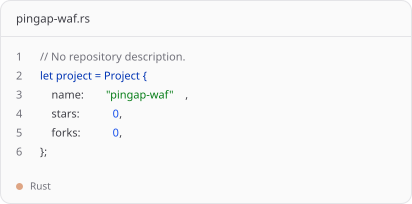
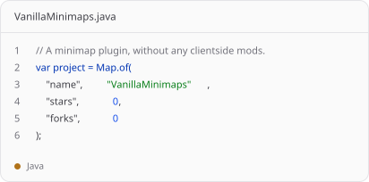
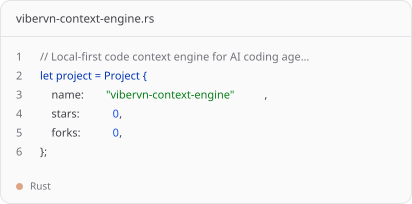
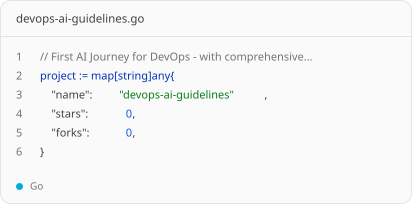
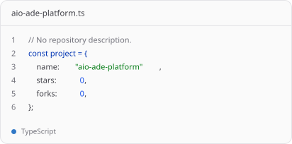
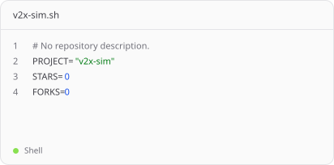

<picture>
  <source media="(prefers-color-scheme: dark)" srcset="readmint/header.dark.svg?v=4b789fd">
  
</picture>

<picture>
  <source media="(prefers-color-scheme: dark)" srcset="readmint/year.dark.svg?v=4b789fd">
  
</picture>

<picture>
  <source media="(prefers-color-scheme: dark)" srcset="readmint/work-languages.dark.svg">
  
</picture>

<a href="https://github.com/keepmeside?tab=repositories">
<picture>
  <source media="(prefers-color-scheme: dark)" srcset="readmint/repo-1-language.dark.svg">
  
</picture>
</a>
<a href="https://github.com/keepmeside?tab=repositories">
<picture>
  <source media="(prefers-color-scheme: dark)" srcset="readmint/repo-2-language.dark.svg">
  
</picture>
</a>

<a href="https://github.com/keepmeside?tab=repositories">
<picture>
  <source media="(prefers-color-scheme: dark)" srcset="readmint/repo-3-language.dark.svg">
  
</picture>
</a>
<a href="https://github.com/keepmeside?tab=repositories">
<picture>
  <source media="(prefers-color-scheme: dark)" srcset="readmint/repo-4-language.dark.svg">
  
</picture>
</a>

<a href="https://github.com/keepmeside?tab=repositories">
<picture>
  <source media="(prefers-color-scheme: dark)" srcset="readmint/repo-5-language.dark.svg">
  
</picture>
</a>
<a href="https://github.com/keepmeside?tab=repositories">
<picture>
  <source media="(prefers-color-scheme: dark)" srcset="readmint/repo-6-language.dark.svg">
  
</picture>
</a>

<picture>
  <source media="(prefers-color-scheme: dark)" srcset="readmint/log.dark.svg?v=4b789fd">
  
</picture>

<picture>
  <source media="(prefers-color-scheme: dark)" srcset="readmint/stack.dark.svg?v=4b789fd">
  
</picture>

<a href="https://github.com/keepmeside">
<picture>
  <source media="(prefers-color-scheme: dark)" srcset="readmint/footer.dark.svg?v=4b789fd">
  
</picture>
</a>
